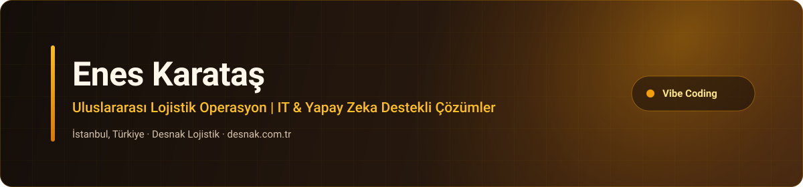

  

  
  
  
  

---

<table>
  <tr>
    <td valign="top" width="52%">
      <h3>🚀 Hakkımda</h3>
      

        🚛 <strong>Desnak Lojistik</strong> bünyesinde <strong>Uluslararası Lojistik Operasyon</strong> süreçlerinde görev alıyorum.  
        🤖 Web Tasarımı lise altyapımı (HTML &amp; CSS) yapay zeka destekli geliştirme (<strong>vibe coding</strong>) araçlarıyla birleştirerek gerçek iş ihtiyaçlarına yönelik dijital çözümler üretiyorum.  
        🖥️ <strong>Orion PC Bilgisayar Otomasyon</strong>'da IT stajyeri olarak kurumsal CCTV güvenlik sistemleri, donanım bakımı ve saha teknik destek deneyimi kazandım.
      

    </td>
    <td valign="top" width="48%">
      <h3>🎯 Odak Alanları &amp; Araçlar</h3>
      

        • Uluslararası Kara Taşımacılığı &amp; Operasyon 
        • Yapay Zeka Destekli Dijital Ürün Geliştirme 
        • Kurumsal IT, CCTV &amp; Saha Teknik Destek 
        • Modern, Hızlı &amp; Çok Dilli Web Arayüzleri
      

      

        
        
        
        
        
      

    </td>
  </tr>
</table>

### 💻 Öne Çıkan Çalışma

| Proje | Açıklama | Özellikler | Bağlantı |
| :--- | :--- | :--- | :---: |
| **🌐 DESNAK Kurumsal Web Sitesi** | Uluslararası kara taşımacılığı yapan DESNAK için yapay zeka destekli geliştirme (*vibe coding*) süreciyle hayata geçirdiğim kurumsal web sitesi. | • 4 Dil: TR, EN, DE, RU • Mobil uyumlu modern arayüz • Hızlı ve SEO odaklı yapı |  |

---

  📍 İstanbul, Türkiye · Sürekli öğrenmeye ve değer üreten dijital projeler geliştirmeye odaklanıyorum.

